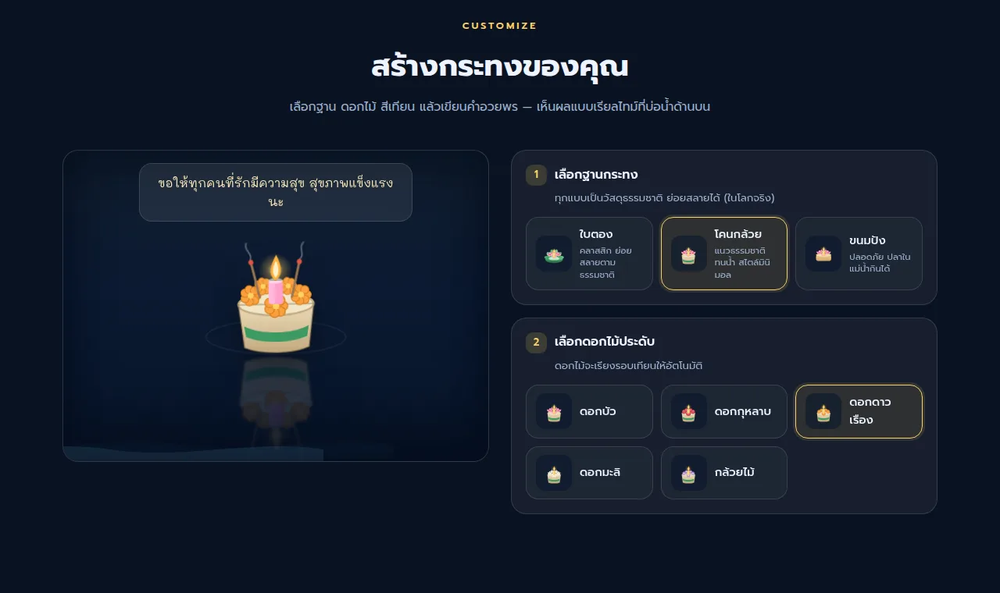

# 🪷 ลอยกระทงออนไลน์

เว็บลอยกระทงเสมือน: ปรับแต่งกระทง เขียนคำอธิษฐาน แล้วปล่อยลอยไปบนสายน้ำ ระหว่างนั้นจะเห็นกระทงของคนอื่นลอยผ่าน และแตะอ่านคำอธิษฐานของเขาได้

- **Frontend** เป็นไฟล์เดียว (`index.html`) ไม่มี build step ไม่มี dependency และวาดกระทงทุกลำด้วย SVG
- **Backend** เป็น PHP REST API + MySQL ในโฟลเดอร์ `api/`
- **ค่าเริ่มต้นรันบน GitHub Pages** ได้ทันทีด้วย Mock backend ในตัว ไม่ต้องมีเซิร์ฟเวอร์


## ความสามารถ

- **ปรับแต่งกระทง**: ฐาน 3 แบบ (ใบตอง โคนกล้วย ขนมปัง) ดอกไม้ 5 แบบ สีเทียน 6 สี และจุดธูปได้ เห็นผลทันทีที่บ่อน้ำตัวอย่าง
- **คำอธิษฐาน** ยาวได้ไม่เกิน 140 ตัวอักษร ลงชื่อหรือไม่ก็ได้ (ไม่เกิน 30 ตัวอักษร)
- **พิธีลอยกระทง** เป็น animation ตอนปล่อยกระทง
- **กระทงของคนอื่นลอยผ่าน** ที่หน้าแรก แตะแล้วจะมี tooltip คำอธิษฐานลอยตามกระทงไป (กระทงจะลอยช้าลงให้อ่านทัน)
- **แกลเลอรีคำอวยพร** แบ่งหน้าแบบ cursor และดึงกระทงใหม่ทุก 12 วินาที
- **สถิติ** จำนวนกระทงทั้งหมดและของวันนี้
- **ลบกระทงของตัวเองได้** ด้วย owner token ที่ได้ตอนลอย
- **ทำงานต่อได้ตอนออฟไลน์** ถ้าต่อเซิร์ฟเวอร์ไม่ได้ จะแสดงข้อมูลสำรองที่เก็บไว้ในเครื่อง



## Backend 3 โหมด

ป้ายมุมขวาบนของหน้าเว็บบอกว่ากำลังใช้โหมดไหน (`MOCK API` / `LIVE API` / `OFFLINE`)

| โหมด | การทำงาน | เหมาะกับ |
|---|---|---|
| `auto` **(ค่าเริ่มต้น)** | ลอง PHP API ที่ `api/` ก่อน ถ้าต่อไม่ได้จะใช้ Mock แทน บน GitHub Pages และตอนเปิดไฟล์ตรง (`file://`) จะใช้ Mock ทันทีโดยไม่ยิง request | ใช้ได้ทุกที่โดยไม่ต้องแก้อะไร |
| `mock` | จำลอง REST API ในเบราว์เซอร์ เก็บข้อมูลใน `localStorage` | เดโม / พัฒนา UI |
| `api` | ใช้ PHP API อย่างเดียว ถ้าต่อไม่ได้จะเข้าโหมดออฟไลน์ | production ที่มี PHP + MySQL |

ตั้งค่าโหมดได้ที่ `CONFIG.backend` ใน `index.html` หรือสลับชั่วคราวผ่าน URL ด้วย `?backend=mock` หรือ `?backend=api`

> **Mock ทำงานในเบราว์เซอร์ของแต่ละคน** คนอื่นจึงไม่เห็นกระทงที่คุณลอย กระทงของคนอื่นใน Mock เป็นข้อมูลสุ่มที่สร้างขึ้นเพื่อจำลองว่ามีคนลอยอยู่ตลอด ถ้าต้องการให้ทุกคนเห็นกระทงของกันและกันจริง ต้องใช้ PHP API

## เริ่มต้นใช้งาน

### 1. GitHub Pages (ค่าเริ่มต้น)

1. Push repo นี้ขึ้น GitHub (หรือ fork)
2. ไปที่ **Settings → Pages → Build and deployment**
   - Source: **Deploy from a branch**
   - Branch: **`main`** โฟลเดอร์ **`/ (root)`** แล้วกด **Save**
3. รอประมาณ 1–2 นาที แล้วเปิด `https://<username>.github.io/<repo>/` ป้ายมุมขวาบนจะขึ้น `MOCK API`

GitHub Pages รัน PHP ไม่ได้ ไฟล์ใน `api/` จึงถูกเสิร์ฟเป็นไฟล์ธรรมดา ซึ่งก็เป็นซอร์สสาธารณะใน repo อยู่แล้ว ส่วน `api/config/config.php` ที่มีรหัสผ่านจริงอยู่ใน `.gitignore` จึงไม่ถูก commit และมีไฟล์ `.nojekyll` ไว้ให้ Pages เสิร์ฟไฟล์ตรง ๆ โดยไม่ผ่าน Jekyll

### 2. เปิดในเครื่องแบบไม่มี backend

ดับเบิลคลิก `index.html` หรือเปิดผ่าน VS Code Live Server ก็จะได้โหมด Mock ทันที

### 3. รันพร้อม PHP + MySQL ในเครื่อง

ต้องมี PHP 8.1+ (มี extension `pdo_mysql` และ `mbstring`) และ MySQL 5.7+ หรือ MariaDB 10.3+

```bash
# 1) สร้างฐานข้อมูล krathong_db + ตาราง + ข้อมูลตัวอย่าง 5 ลำ
mysql -u root -p < api/schema.sql

# 2) สร้างไฟล์ตั้งค่าจากต้นแบบ
cp api/config/config.example.php api/config/config.php

# 3) สุ่ม app_secret แล้วนำไปใส่ใน config.php พร้อมแก้ user/pass ของ DB
php -r "echo bin2hex(random_bytes(32)), PHP_EOL;"

# 4) รัน
php -S localhost:8000
```

เปิด http://localhost:8000 ป้ายมุมขวาบนต้องขึ้น `LIVE API`

> `php -S` ไม่อ่าน `.htaccess` จึงไม่ได้กันไฟล์ใน `api/config/`, `api/src/` และ `schema.sql` ใช้สำหรับพัฒนาเท่านั้น

### 4. ขึ้นโฮสต์จริง (Apache / shared hosting)

1. อัปโหลด `index.html` และโฟลเดอร์ `api/` วางที่ root ของโดเมนหรือใน subfolder ก็ได้ เพราะ API หา base path เองจากตำแหน่งของ `api/index.php`
2. Import `api/schema.sql` ผ่าน phpMyAdmin หรือ `mysql` (ถ้าโฮสต์สร้าง DB ให้แล้วด้วยชื่ออื่น ให้ลบบรรทัด `CREATE DATABASE` / `USE` ออกก่อน)
3. สร้าง DB user ที่มีสิทธิ์แค่ `SELECT, INSERT, UPDATE, DELETE` (มีคำสั่งตัวอย่างคอมเมนต์ไว้ใน `schema.sql`) ไม่ควรใช้ root
4. สร้าง `api/config/config.php` จาก `config.example.php` แล้วใส่ค่า DB และ `app_secret`
5. เอาคอมเมนต์บรรทัดบังคับ HTTPS ใน `api/.htaccess` ออก
6. ทดสอบที่ `https://yourdomain.com/api/krathongs/stats` ต้องได้ JSON `{"total":…,"today":…}`

ต้องใช้ Apache ที่เปิด `mod_rewrite` และอนุญาต `.htaccess` (`AllowOverride All`) โดย `api/.htaccess` จะส่งทุก request ไปที่ `index.php` และกัน `config/`, `src/` และไฟล์ `.sql` ไว้

<details>
<summary><b>nginx + PHP-FPM</b></summary>

กรณีวางที่ root ของโดเมน (ถ้าวางใน subfolder ให้เปลี่ยน `/api/` เป็น `/<subfolder>/api/`)

```nginx
server {
    root  /var/www/krathong;
    index index.html;

    location ^~ /api/ {
        location ~ ^/api/(config|src)/ { deny all; }
        location ~ \.sql$            { deny all; }
        location = /api/index.php {
            include fastcgi_params;
            fastcgi_param SCRIPT_FILENAME $document_root$fastcgi_script_name;
            fastcgi_pass unix:/run/php/php8.4-fpm.sock;
        }
        try_files $uri /api/index.php$is_args$args;
    }
}
```
</details>

### 5. Frontend บน GitHub Pages + API บนโฮสต์อื่น

1. ติดตั้ง API ตามข้อ 4 บนโฮสต์ที่มี **HTTPS** (หน้า Pages เป็น https จึงเรียก API แบบ http ไม่ได้)
2. แก้ `index.html`: `apiBaseUrl: 'https://api.yourdomain.com/api'`
   เมื่อ `apiBaseUrl` เป็น URL เต็ม โหมด `auto` บน Pages จะลองต่อ API จริงก่อน
3. แก้ `config.php`: เพิ่ม `'https://<username>.github.io'` ใน `allowed_origins` (ใส่แค่ origin ไม่ต้องมี path ของ repo)

## การตั้งค่า

### Frontend: `CONFIG` ใน `index.html`

| คีย์ | ค่าเริ่มต้น | ความหมาย |
|---|---|---|
| `apiBaseUrl` | `'api'` | ที่อยู่ API แบบ relative กับหน้าเว็บ หรือ URL เต็ม |
| `backend` | `'auto'` | `auto` / `api` / `mock` (ดู[ด้านบน](#backend-3-โหมด)) |
| `pollInterval` | `12000` | ดึงกระทงใหม่ทุกกี่ ms |
| `requestTimeout` | `8000` | timeout ของแต่ละ request (ms) |
| `pageSize` | `12` | จำนวนการ์ดต่อหน้าในแกลเลอรี |
| `maxDriftOnScreen` | `12` | จำนวนกระทงที่ลอยบนจอพร้อมกันได้สูงสุด |

### Backend: `api/config/config.php`

| คีย์ | ความหมาย |
|---|---|
| `db` | host / port / name / user / pass / charset ของ MySQL |
| `app_secret` | hex 64 ตัว ใช้ทำ HMAC ของ IP และ owner token **API จะไม่ทำงานถ้ายังเป็นค่าตัวอย่าง** |
| `allowed_origins` | CORS allowlist ใส่เฉพาะเมื่อหน้าเว็บอยู่คนละ origin กับ API |
| `trust_proxy_headers` | `true` เฉพาะเมื่ออยู่หลัง proxy/CDN ที่เชื่อถือได้ (เช่น Cloudflare) |
| `rate_limits` | `read` 120 ครั้ง/นาที · `write` 10 ครั้ง/ชม. · `delete` 10 ครั้ง/ชม. ต่อ IP |
| `max_body_bytes` | ขนาด body สูงสุดของ POST (ค่าเริ่มต้น 2048) |
| `delete_window_hours` | ถ้าไม่มี token จะลบได้ด้วย IP เดิมภายในกี่ชั่วโมง (ค่าเริ่มต้น 24) |
| `stats_timezone` | timezone ที่ใช้นับ "วันนี้" (ค่าเริ่มต้น `Asia/Bangkok`) |

## REST API

ทุก response เป็น JSON และเก็บเวลาเป็น UTC ในรูปแบบ ISO 8601 (`2026-10-29T07:40:24.409Z`)

| Method | Path | คำอธิบาย | สำเร็จ |
|---|---|---|---|
| `GET` | `/krathongs?limit=12&cursor=…` | รายการล่าสุด (`limit` 1–50) | `200 {items, nextCursor, total}` |
| `GET` | `/krathongs/latest?since=<ISO>&limit=10` | กระทงที่ลอยหลังเวลา `since` (`limit` 1–20) | `200 {items}` |
| `GET` | `/krathongs/stats` | จำนวนทั้งหมดและของวันนี้ | `200 {total, today}` |
| `POST` | `/krathongs` | ลอยกระทง | `201 {item, ownerToken}` |
| `DELETE` | `/krathongs/{id}` | ลบ (ส่ง header `X-Owner-Token`) | `204` |

`nextCursor` เป็นค่าทึบ ให้ส่งกลับมาตามเดิม ถ้าเป็น `null` แปลว่าหมดแล้ว

**Body ของ `POST /krathongs`**

```json
{
  "base": "tong",
  "flower": "lotus",
  "candle": "gold",
  "incense": true,
  "message": "ขอให้ความทุกข์ทั้งหลายจมหายไปกับสายน้ำ",
  "name": "ปอนด์"
}
```

| ฟิลด์ | ค่าที่รับ |
|---|---|
| `base` | `tong` · `stem` · `bread` |
| `flower` | `lotus` · `rose` · `marigold` · `jasmine` · `orchid` |
| `candle` | `gold` · `coral` · `pink` · `blue` · `lavender` · `mint` |
| `incense` | boolean |
| `message` | จำเป็น ไม่เกิน 140 ตัวอักษร (ตัดช่องว่างซ้ำและอักขระควบคุมออก) |
| `name` | ไม่บังคับ ไม่เกิน 30 ตัวอักษร |

ผลลัพธ์คือ `item` (รูปแบบเดียวกับใน `items` ของ GET) และ `ownerToken` ให้เก็บไว้ส่งเป็น `X-Owner-Token` ตอนลบ ถ้าไม่มี token จะลบได้จาก IP เดิมภายใน `delete_window_hours`

**Error**: ทุกกรณีตอบเป็น `{"status": 400, "code": "VALIDATION", "message": "…"}`

| HTTP | `code` | เมื่อไร |
|---|---|---|
| 400 | `VALIDATION` · `INVALID_JSON` · `EMPTY_BODY` | ข้อมูลไม่ผ่าน / JSON เสีย / ไม่มี body |
| 403 | `FORBIDDEN` | ลบกระทงที่ไม่ใช่ของตัวเอง |
| 404 | `NOT_FOUND` | ไม่พบกระทง หรือ path ไม่มีอยู่ |
| 405 | `METHOD` | method ไม่รองรับ |
| 413 | `BODY_TOO_LARGE` | body เกิน `max_body_bytes` |
| 429 | `RATE_LIMITED` | เรียกถี่เกินกำหนด (ดูได้จาก header `Retry-After`) |
| 500 | `NOT_CONFIGURED` · `INTERNAL` | ยังไม่ได้สร้าง config / secret ไม่ถูกต้อง / ข้อผิดพลาดภายใน |

**ตัวอย่าง**

```bash
curl https://yourdomain.com/api/krathongs/stats

curl -X POST https://yourdomain.com/api/krathongs \
  -H 'Content-Type: application/json' \
  -d '{"base":"tong","flower":"lotus","candle":"gold","incense":true,"message":"ขอให้มีความสุข"}'

curl -X DELETE https://yourdomain.com/api/krathongs/<id> -H 'X-Owner-Token: <ownerToken>'
```

Mock backend ใน `index.html` ทำงานตาม contract เดียวกันนี้ทุก endpoint รวมถึง `ownerToken` และ HTTP status ของ error จึงพัฒนา UI กับ Mock แล้วสลับไปใช้ API จริงได้เลย

## ความปลอดภัย

- **SQL injection**: ใช้ prepared statement จริงทุก query (`PDO::ATTR_EMULATE_PREPARES = false`)
- **ความเป็นส่วนตัว**: ไม่เก็บ IP ดิบ เก็บแค่ HMAC-SHA256 ของ IP ที่ใช้ `app_secret` เป็นกุญแจ
- **การลบ**: owner token เป็น HMAC ของ id จึงไม่ต้องเก็บ session (stateless) และเทียบค่าแบบ timing-safe
- **Rate limit**: เก็บใน MySQL แบบ fixed window ต่อ IP ไม่ต้องมี Redis หรือ cron
- **Input**: จำกัดขนาด body และความลึกของ JSON ตรวจ enum และความยาว ลบอักขระควบคุม และมี honeypot ฟิลด์ `website` ไว้ดักบอท
- **XSS**: frontend แสดงข้อความของผู้ใช้ด้วย `textContent` เสมอ
- **Header**: `nosniff`, `X-Frame-Options: DENY`, `Referrer-Policy: no-referrer`, `Cache-Control: no-store` และ HSTS เมื่อเป็น HTTPS
- **CORS**: อนุญาตเฉพาะ origin ที่อยู่ใน allowlist

> ถ้า PHP อยู่หลัง reverse proxy (nginx, load balancer) ทุก request จะเห็น IP เป็นของ proxy ทำให้ rate limit ใช้โควตาร่วมกันทั้งเว็บ ให้ตั้ง `trust_proxy_headers` เป็น `true` เฉพาะเมื่อ proxy เขียนทับ header เอง (เช่น `CF-Connecting-IP` ของ Cloudflare) ไม่เช่นนั้นผู้ใช้จะปลอม `X-Forwarded-For` เพื่อเลี่ยง rate limit ได้

## โครงสร้างโปรเจ็ค

```
.
├── index.html                 # Frontend ทั้งหมด (HTML + CSS + JS + Mock API)
├── .nojekyll                  # ให้ GitHub Pages เสิร์ฟไฟล์ตรง ๆ
├── docs/                      # ภาพประกอบ README
└── api/
    ├── .htaccess              # front controller + กัน config/src/sql (Apache)
    ├── index.php              # router ของ REST API
    ├── schema.sql             # ตาราง krathongs, api_rate_limits + ข้อมูลตัวอย่าง
    ├── config/
    │   ├── config.example.php # ต้นแบบ (commit ได้)
    │   └── config.php         # ค่าจริง (อยู่ใน .gitignore)
    └── src/
        ├── ApiException.php
        ├── Database.php       # PDO + session time_zone UTC
        ├── Http.php           # JSON response / อ่าน body
        ├── KrathongRepository.php
        ├── RateLimiter.php
        ├── Security.php       # header, CORS, IP hash, owner token
        └── Validator.php
```

## ล้างข้อมูล Mock

ข้อมูลของโหมด Mock อยู่ใน `localStorage` ของเบราว์เซอร์ ล้างได้จาก DevTools → Application → Storage → **Clear site data** หรือลบเฉพาะคีย์ `mockapi.krathongs.v2` แล้วรีเฟรชหน้า ระบบจะสร้างข้อมูลตัวอย่างชุดใหม่ให้
